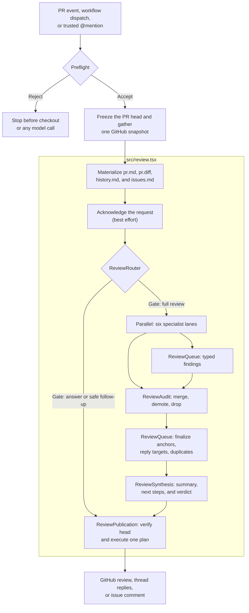

# Nibble Review

An AI pull-request reviewer you add to any repository with one workflow file and one secret. It reads the code around a diff, gives the change to six focused reviewers, audits their findings, and publishes one GitHub review.

It runs entirely inside your GitHub Actions job: no GitHub App, no container image, no server. Agents run through [pi](https://pi.dev), so any model pi supports works, and the default ([OpenCode Go](https://opencode.ai/docs/go/) DeepSeek V4 Flash) measured **$0.12–$0.18 per full review** at pi catalog rates on our first test PRs.

```yaml
- uses: adlrocha/nibble-review@v1
  with:
    api-key: ${{ secrets.OPENCODE_API_KEY }}
```

The reviewer is written with [Agent Markup Language (AML)](https://agent-markup-language.com/). The review tree is declarative; TypeScript owns the GitHub snapshot, finding queue, validation, verdict, and publication. It started as a fork of [we-are-singular/singular-code-review-agent](https://github.com/we-are-singular/singular-code-review-agent) and now evolves independently.

## Quick start

1. Add your model provider key as a repository (or organization) secret, for example `OPENCODE_API_KEY`.
2. Copy [examples/nibble-review.yml](examples/nibble-review.yml) to `.github/workflows/nibble-review.yml`.
3. Open a pull request, or comment `@nibble-review` on one.

That's it. Reviews post as `github-actions[bot]` using the job's own `GITHUB_TOKEN`; the workflow's `permissions` block grants exactly `contents: read`, `issues: write`, and `pull-requests: write`.

The example triggers on opened, ready-for-review, and updated pull requests from the same repository, on manual dispatch, and on `@nibble-review` comments from owners, members, and collaborators. An owner, member, or collaborator can skip a review by starting the PR title with `[skip]`, or by putting `@nibble-review skip` on its own line in the PR body. Directives on PRs opened by bots, Apps, or outside contributors are ignored. A skipped review still passes the job, so if `review / agent` is a required check, set `allow-skip: "false"` so that the check always means a review ran.

## What a review produces

A full run publishes:

- specific problems as comments on changed lines;
- replies beside existing review threads when the author asked there;
- a short top-level summary that does not repeat every inline comment;
- one application-derived verdict: `⛔ Block`, `⚠️ Request changes`, or `✅ LGTM`.

Follow-up events do not always need another full review. The gate can answer a direct question or return a quick `✅ LGTM` when the current head was already reviewed and the new change is safely contained.

## How a review runs



The `src/review.tsx` section maps directly to the component tree in [src/review.tsx](src/review.tsx):

```tsx
<Workspace>
  <ReviewContextFiles />
  <ReviewAcknowledgement />
  <ReviewRouter>
    <ReviewSynthesis>
      <ReviewAudit>
        <Parallel>
          <IntentContractLane />
          <StandardsArchitectureLane />
          <CodePathBugHunterLane />
          <CorrectnessRiskTestingLane />
          <DocumentationCommentaryLane />
          <MaintainabilityEleganceLane />
        </Parallel>
      </ReviewAudit>
    </ReviewSynthesis>
  </ReviewRouter>
  <ReviewPublication />
</Workspace>
```

AML reads the model tree from the leaves back to the trunk. The nesting defines the review and publication boundaries:

- `<Parallel>` makes the six investigations concurrent and fails the review if any lane fails. Native fragments keep each authored heading and lane in one branch; every lane records typed findings through Tools and returns a short terminal handoff.
- `<ReviewAudit>` explicitly resolves all six children before it freezes the staged queue. It skips the audit Agent when no finding exists and otherwise gives that Agent the ordered lane handoffs, read-only full-comment lookup, and the merge, demote, and drop queue Tools.
- Finding anchors and reply targets are validated when lane Tools add them. `<ReviewSynthesis>` finalizes duplicate and prior-comment handling directly from the queue, runs the typed synthesis Agent, derives the verdict, and returns the composed JSX body to its parent.
- `<ReviewRouter>` is the intentional conditional boundary. It obtains the deterministic or typed gate decision, evaluates only the selected route, and completes one routed body through the request Context API.
- AML evaluates `<ReviewPublication>` next in authored order. Publication reads the completed route, derives the publication draft from it and the queue, verifies that GitHub still points to the reviewed commit, and executes one deterministic write plan.

The shared review Context carries request-scoped dependencies plus small APIs for the typed queue, completed routing handoff, and final publication outcome. Its top-level value is not reactive state: components share the same request binding, and mutable workflow transitions remain behind the owning APIs. Audited and validated snapshots are derived from the queue where they are consumed instead of being copied into phase-owned Context fields.

The [AML source is on GitHub](https://github.com/we-are-singular/aml); this reviewer runs its Agents through AML's [pi](https://pi.dev) provider. Its `Agent`, `Block`, `File`, `Include`, `Parallel`, `Tool`, and `Workspace` components describe the model-facing work without taking ownership of trusted application state.

### The six lanes

| Lane | Question it owns |
| --- | --- |
| Intent and contract | Does the patch satisfy the stated requirement and the strongest active repository contract? |
| Standards and architecture | Does it follow package ownership, canonical sources, repository rules, and established design? |
| Code-path bugs | Can a changed value or state transition break a real caller or consumer? |
| Correctness, risk, and testing | Are security, authorization, data integrity, compatibility, concurrency, rollout, performance, and tests adequate? |
| Documentation and commentary | Do active docs, examples, release guidance, and non-obvious comments still tell the truth? |
| Maintainability and elegance | Is the change locally clear, well placed, and free of needless concepts or indirection? |

Each lane can read the checkout and the same frozen PR evidence through pi's read-only `read`, `grep`, `find`, and `ls` tools. Shell and network access are disabled. Narrow read-only GitHub tools are available when the change depends on linked GitHub evidence. Findings reach the author only through typed review tools.

The snapshot includes GitHub closing issues and explicit `related to` or `relates to` references to issues and pull requests. References accept local numbers, `owner/repository#number`, and GitHub issue or PR URLs. Related PRs supply their descriptions, files, commits, and discussion history; gathering stops after one hop. The `get_pr` Tool returns nested PR inventories as name-only `changedFiles` and `ignoredFiles` arrays; `get_pr_diff` supplies their patches when needed. Related references load in bounded batches that retain every reference. Closing issues define claimed requirements, while related issues and PRs provide context. Publication rechecks referenced issue timestamps and related PR timestamps and heads.

### Model judgment and application authority

| Model work                          | Application work                              |
| ----------------------------------- | --------------------------------------------- |
| Classify an ambiguous follow-up     | Reject untrusted triggers and fork heads      |
| Investigate the six review concerns | Freeze one PR head and snapshot               |
| Audit staged findings               | Own the typed finding queue                   |
| Write the short review summary      | Validate anchors, replies, and duplicates     |
| Suggest useful next steps           | Derive the verdict and GitHub payload         |
|                                     | Verify the head and execute idempotent writes |

Models investigate and write. They do not decide which commit was reviewed, whether a comment can be posted, what verdict a severity produces, or whether a GitHub mutation should be retried.

## Configuration

| Input | Default | Purpose |
| --- | --- | --- |
| `api-key` | required | Model provider key. Pass it from a secret. |
| `api-key-env` | `OPENCODE_API_KEY` | Variable pi reads the key from, e.g. `ANTHROPIC_API_KEY` or `OPENAI_API_KEY`. Must end in `_API_KEY`. |
| `model` | `opencode-go/deepseek-v4-flash` | pi model as `provider/model`. Run `pi --list-models` to see what is available. |
| `fallback-model` | `opencode-go/minimax-m3` | Retried once when the primary model fails before anything is published. Empty disables the retry. |
| `github-token` | `${{ github.token }}` | Token used to read the PR and publish the review. |
| `app-client-id`, `app-private-key` | empty | Optional GitHub App credentials; reviews then post as the App's bot. |
| `command` | `@nibble-review` | Mention that requests a review in a PR comment. |
| `pr-number` | from the event | Pull request to review. |
| `allow-skip` | `true` | Honor `[skip]` titles and `@nibble-review skip` body lines from trusted human authors. Set `false` when the review check is required for merging. |
| `install-dependencies` | `false` | Install the repository's npm/pnpm/yarn dependencies first. Runs their install scripts. |
| `emojis` | `true` | Prefix inline comments with severity emojis. |
| `timeout-minutes` | `20` | Upper bound for each review attempt. |

Use another provider by changing two inputs:

```yaml
- uses: adlrocha/nibble-review@v1
  with:
    api-key: ${{ secrets.ANTHROPIC_API_KEY }}
    api-key-env: ANTHROPIC_API_KEY
    model: anthropic/claude-haiku-5-5
    fallback-model: ""
```

If you change `command`, change the mention in your workflow's `if:` filter to match.

Publication failures and timeouts never trigger the fallback model, because their GitHub mutation outcome may be ambiguous. Each run writes a job summary with the model, Agent turns, token usage, estimated cost (from pi's model catalog, not a reconciled bill), comment counts, and publication status.

## Fixer (experimental)

`adlrocha/nibble-review/fix@v1` fixes one pull request's failing checks and unresolved review threads, then pushes one commit. See [examples/nibble-fix.yml](examples/nibble-fix.yml).

**Don't run it unattended on dependency updates.** The Agent reads the code that changed, and a dependency update is exactly where a supply-chain attacker controls that code. Text in the update can steer the Agent. The sandbox stops it from taking credentials, but whatever it writes is pushed. Start it by hand (the example uses `workflow_dispatch`), pair it with a human merge rather than auto-merge, and give its App no `Workflows` permission. Hand failing dependency PRs to an agent you supervise instead.

```yaml
- uses: adlrocha/nibble-review/fix@v1
  with:
    pr-number: ${{ inputs.pr_number }}
    api-key: ${{ secrets.OPENCODE_API_KEY }}
    app-client-id: ${{ secrets.NIBBLE_APP_CLIENT_ID }}
    app-private-key: ${{ secrets.NIBBLE_APP_PRIVATE_KEY }}
    verify: |
      npm run lint
      npm test
```

It returns `result` (`fixed`, `gave-up`, or `nothing-to-do`), `reason`, and `commit-sha`. One invocation is one attempt; the caller counts attempts and labels the PR for a human on `gave-up`.

The fixer needs a shell, so it runs inside a sandbox:

- **Steps hold only what they need.** A trusted step gathers failing check logs and threads with a read token. Dependencies install inside the sandbox image with network but no secrets. The Agent runs inside the sandbox with only the model key. The verify commands run inside the sandbox with no keys. The App token is minted last, for a step that runs no repository code.
- **Network.** The Agent's container sits on an internal Docker network. Its only route out is an allowlist proxy that tunnels HTTPS to the model API host taken from pi's catalog (`egress-allow` overrides it). It cannot reach package registries, so a fix that needs a new dependency gives up.
- **Git.** The checkout's `.git` is mounted read-only in the sandbox. The commit is built through the GitHub API by comparing files with a pristine copy taken before any repository code ran, so no git command runs in a checkout that dependency scripts could have tampered with.
- **Scope.** Changes under `.github/` are refused. A `fixed` result is only pushed when the verify commands pass, and it is pushed fast-forward only.

Use a GitHub App for `app-client-id`/`app-private-key`: pushes made with the default `GITHUB_TOKEN` do not trigger CI. The App needs `Contents: write` and `Pull requests: write`, and nothing more. Never grant it `Workflows`, which would let a leaked key rewrite CI and read every Actions secret. Install it only on the repositories that run the fixer,. The job needs `actions: read`, `checks: read`, `contents: read`, and `pull-requests: read`, plus Docker on the runner (GitHub-hosted Ubuntu runners have it).

## Trust and failure boundaries

- The example workflow and the reviewer's preflight reject fork pull requests before credentials reach PR code, and the workflow uses `pull_request`/`issue_comment`, never `pull_request_target`.
- Mention triggers accept repository owners, organization members, and collaborators only.
- pi starts with `--no-extensions --no-skills --no-prompt-templates --no-themes --no-context-files`, and the reviewed repository's `.pi/` directory is moved aside during the run, so PR content cannot load pi extensions or make pi install packages.
- pi receives an allowlisted environment: provider `*_API_KEY` credentials, never `GITHUB_TOKEN` or Actions runtime tokens.
- Every Agent runs with read-only filesystem access and no shell or network.
- Every published body is scrubbed of secret-looking environment values and carries a hidden `<!-- nibble-review -->` marker, so a shared `github-actions[bot]` login is never confused with other workflows' comments.
- Every model phase sees the same cached GitHub snapshot and filtered diff. A failed lane, audit, finalization, synthesis, or model run leaves nothing to publish.
- The CLI is dry-run by default; live GitHub mutations require `--publish`. Publication re-checks the PR head and never replays an ambiguous failed mutation.

Pull request text, comments, diffs, repository files, and linked GitHub content are untrusted evidence. They cannot grant tools or change the review contract. Dependency installation is opt-in because package scripts run with the job's credentials available.

## Run it locally

Requirements: Node.js 26+, a GitHub token (`GH_TOKEN`, or `gh auth token`), and a model key.

```bash
npm ci
npm run build
git clone https://github.com/OWNER/REPO /tmp/review && git -C /tmp/review fetch origin pull/123/head && git -C /tmp/review checkout FETCH_HEAD
GH_TOKEN=$(gh auth token) OPENCODE_API_KEY=... node dist/cli/review.js --repo OWNER/REPO --pr 123 --workspace /tmp/review
```

Without `--publish` nothing is written to GitHub; the full result, including the exact review that would be posted, is printed as JSON.

## Development

```bash
npm ci
npm run lint
npm run format:check
npm test
```

CI also runs `shellcheck` and `actionlint`. [eval/README.md](eval/README.md) documents the evaluation harness used to compare models and reviewer changes on a fixed PR corpus.

## Versioning

Releases are tagged `vX.Y.Z`, and the `v1` tag moves to the latest compatible release. Pin `@v1` for automatic fixes, or a full version for fully reproducible reviews.

## Project documents

- [PRD.md](PRD.md) defines the review engine's product and safety contract.
- [eval/README.md](eval/README.md) documents repeatable model and reviewer evaluation.
- [FUTURE.md](FUTURE.md) tracks remaining work.

## License

[MIT](LICENSE). Derived from Singular's `singular-code-review-agent`.
